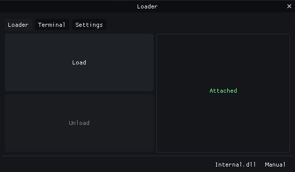
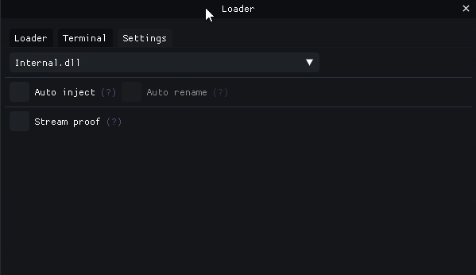
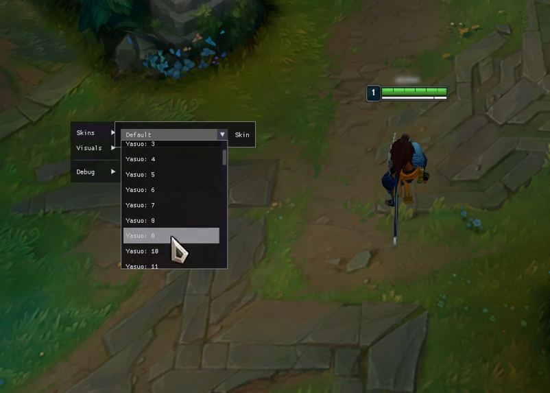
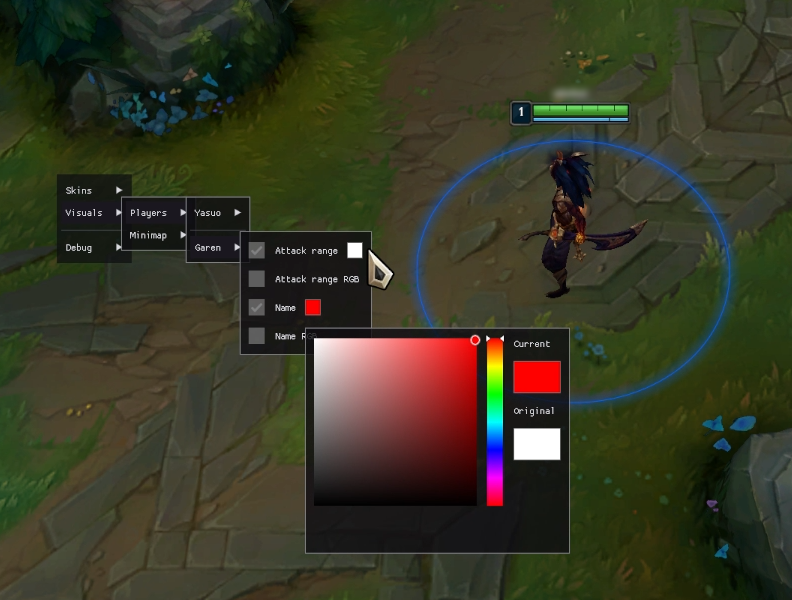
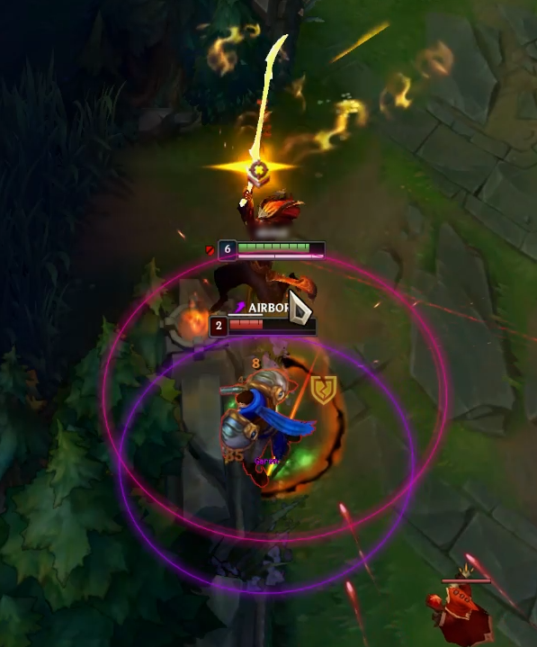
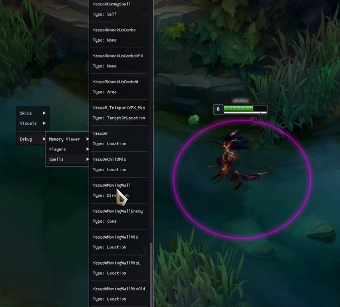
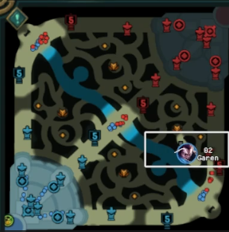

   # **Private Internal League Software**

   
   
   

## Description:
This internal dlc project **had some bright future** of implementing **Evade** from scratch as well as **combining two other project** that we made into one.
However, beloved company decided to say that putting rootkits in your kernel is a new standard, so this unfinished project might get public as soon as ring-0 AC is implemented.

I've put  all of my soul into this code, I tried to make it clear, easy to read, debug and follow. But it doesn't matter anymore I guess.

## Features
- [ ] **ManualMap Loader/Unloader**
- [ ] **Evade**
- [ ] **Skillshot aimbot** / **Prediction**
- [ ] **Orbwalker**
- [x] **Skin Changer**
- [ ] **Visual Awareness**

 

## Screenshots:

### Injector

### Game

### Missile list

### Minimap tracker

